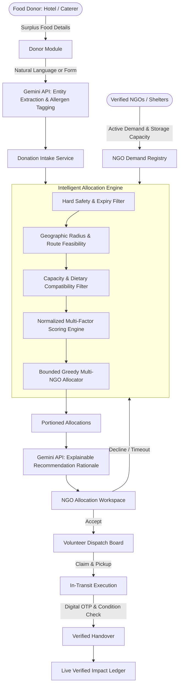

# FoodBridge AI — Intelligent Food Rescue & Multi-NGO Allocation System

[](https://github.com/keshavkokre/foodbridge-ai)
[](https://github.com/keshavkokre/foodbridge-ai)
[](https://github.com/keshavkokre/foodbridge-ai)
[-236548?style=for-the-badge)](https://github.com/keshavkokre/foodbridge-ai)

> An intelligent, demand-first surplus food rescue and redistribution system engineered for **TECH EMBED 2026**. FoodBridge AI moves beyond passive donation listing boards by calculating safe-use windows, evaluating physical NGO receiving capacity, and automatically portioning large commercial surplus batches across multiple nearby verified shelters.

---

## 1. Core Problem & System Innovation

Commercial hospitality, supermarkets, and banquet halls discard metric tons of edible surplus food daily. Traditional redistribution platforms function as passive "first-come, first-served" bulletin boards. When a hotel produces 180 servings of fresh cooked meals, individual community shelters (which typically house 25 to 50 residents) cannot accept the batch without violating their physical refrigeration or volunteer storage limits. Consequently, surplus food expires and enters landfills.

### Key Differentiators of FoodBridge AI
1. **Demand-First Intake:** Relief organizations continually publish active dietary requirements, daily receiving capacity limits, and operating hours.
2. **Hybrid Deterministic + AI Architecture:** Strict food safety rules, capacity feasibility, and allocation portioning are executed **100% deterministically in the backend**. Configurable Gemini API models are used strictly for non-critical unstructured text parsing and natural language rationale generation, with full offline deterministic fallbacks.
3. **Multi-NGO Fractional Allocation:** Large donations are automatically portioned across multiple proximate, verified NGOs without exceeding any organization's remaining capacity or demand.
4. **Idempotent Application-Level Expiration & Reallocation:** Expired proposals are scanned, audited, and returned to the unallocated pool for re-dispatch without relying on passive database document deletion.
5. **Zero-Knowledge Handover Verification:** Cryptographically hashed one-time passwords (OTPs) and milestone-based geocoordinate confirmations safeguard chain-of-custody without invasive background tracking.

---

## 2. System Architecture



---

## 3. "Harvest Signal" Design System

The product UI is designed intentionally around **Harvest Signal**—an editorial, warm, and operationally rigorous visual language:

- **Warm Ivory (`#F6F7F1`):** Base canvas creating a tactile, editorial foundation.
- **Card White (`#FFFFFF`):** High-contrast elevated content surfaces with sharp hairline borders (`#E4E8DF`).
- **Forest Green (`#174C35` / `#0B2118`):** Botanical authority for headers, sidebars, and critical CTAs.
- **Soft Lime (`#B9E76A`):** High-visibility harvest signal accent for statuses, tags, and verified badges.
- **Muted Amber (`#E8A46A`):** Warning indicator for near-expiry safe-use countdowns.
- **Typography:** `Manrope` for structural headings, `DM Sans` for body text and tabular operational metrics.

---

## 4. Evaluation Personas for Hackathon Judges

Judges can test the complete vertical slice immediately using the pre-seeded demonstration credentials (or use the one-click launcher buttons on `/auth`):

| Role | Account Email | Password | Persona Description |
| :--- | :--- | :--- | :--- |
| **Donor (Hotel)** | `hotel.donor@foodbridge.demo` | `DemoPassword2026!` | Grand Palace Hotel & Banquets (150-serving banquet surplus) |
| **Donor (Market)** | `market.donor@foodbridge.demo` | `DemoPassword2026!` | FreshHarvest Organics Supermarket (produce & groceries) |
| **NGO (Children)** | `ashraya.shelter@foodbridge.demo` | `DemoPassword2026!` | Ashraya Children Home (capacity: 75 servings, 1.4 km from donor) |
| **NGO (Seniors)** | `sneha.care@foodbridge.demo` | `DemoPassword2026!` | Sneha Care Senior Sanctuary (capacity: 50 servings, 3.2 km from donor) |
| **NGO (Kitchen)** | `stjude.kitchen@foodbridge.demo` | `DemoPassword2026!` | St. Jude Community Kitchen (capacity: 100 servings, 5.0 km from donor) |
| **Volunteer** | `rohan.volunteer@foodbridge.demo` | `DemoPassword2026!` | Rohan Sharma (Volunteer Driver with compact vehicle) |
| **Admin** | `admin@foodbridge.demo` | `DemoPassword2026!` | Ananya Deshmukh (Compliance Officer) |

---

## 5. Quickstart & Local Installation

### Prerequisites
- Node.js (v20+ or v24+)
- npm (v10+ or v11+)

### 1. Clone Repository & Install Dependencies
```bash
git clone https://github.com/keshavkokre/foodbridge-ai.git
cd foodbridge-ai

# Installs root, client, and server dependencies concurrently
npm install
```

### 2. Configure Environment Variables
Copy `.env.example` to `.env`:
```bash
cp .env.example .env
```
*(Optional: Provide a `GEMINI_API_KEY` from Google AI Studio. If omitted, the engine automatically uses its built-in deterministic heuristic fallback).*

### 3. Seed Realistic Demonstration Data
```bash
npm run seed
```

### 4. Run Automated Test Suite
```bash
npm test
```
*Executes all 37 unit, invariant, security, admin compliance, and end-to-end workflow tests across 7 test suites via Vitest.*

### 5. Launch Full-Stack Application
```bash
npm run dev
```
- **Frontend Application:** `http://localhost:5173`
- **Backend REST API:** `http://localhost:5000`
- **Health Preflight Endpoint:** `http://localhost:5000/api/health`

---

## 6. Mathematical Invariants & Scoring Formulations

### Invariants Guaranteed
1. **Donation Conservation:** $\sum_{k=1}^m q_k \le Q_D$ (Total allocated servings strictly cannot exceed available donation quantity).
2. **Shared Daily NGO Capacity Ceiling:** For any NGO $N_j$, the sum of all allocations across all active demands cannot exceed their physical daily limit: $\sum q_i + Load_j \le Cap_{total, j}$.
3. **Corrected Urgency Inversion:** Urgency score increases ($U_{time} \to 1.0$) as remaining safe-use time diminishes ($T_{rem} \to 0$).
4. **Strict Normalization:** All constituent scores ($S_{dist}, S_{urgency}, S_{capacity}, S_{history}$) are bounded in $[0.0, 1.0]$.
5. **Partial Fulfillment & Explicit Remainder:** Unallocated portions are explicitly tracked in `remainingServings`.

### Normalized Composite Scoring
$$\Phi(D, R_i) = 100 \times \left( 0.35 \cdot S_{dist} + 0.30 \cdot S_{urgency} + 0.20 \cdot S_{capacity} + 0.15 \cdot S_{history} \right)$$

---

## 7. Verified Impact Accounting & References

FoodBridge AI distinguishes between **100% verified hard metrics** and **modeled environmental estimates**:

1. **Serving Counts:** Summed strictly from digital dual-OTP handovers confirmed on-site by both donor and NGO receivers.
2. **Food Waste Prevented (kg):** Computed as $\text{Servings} \times 0.42\text{ kg/serving}$ citing the **UNEP Food Waste Index Report standard portion baseline**.
3. **Greenhouse Gas Abatement (kg CO2e):** Computed as $\text{Waste (kg)} \times 2.5\text{ kg CO}_2\text{e/kg}$ citing the **UN Food and Agriculture Organization (FAO) Food Wastage Footprint methodology**.
4. **Water Footprint Conserved (Liters):** Modeled using the **Water Footprint Network global average agricultural embodied water index** (~350 L per kg of composite food).

---

## 8. Free-Tier Cloud Deployment Guide (Render + MongoDB Atlas)

### Single-Service Render Web Deployment (API + React SPA)
1. In the [Render Dashboard](https://dashboard.render.com), create a new **Web Service** connected to `keshavkokre/foodbridge-ai`.
2. Configure build & runtime:
   - **Runtime:** `Node`
   - **Build Command:** `npm install && npm run build`
   - **Start Command:** `npm start`
3. Configure Environment Variables in Render:
   - `NODE_ENV=production`
   - `PORT=5000`
   - `MONGODB_URI=mongodb+srv://<user>:<password>@cluster0.example.mongodb.net/foodbridge?retryWrites=true&w=majority` (optional; falls back to persistent storage if omitted)
   - `JWT_SECRET=your_secure_64_char_random_secret`
   - `GEMINI_API_KEY=your_gemini_key` (optional; built-in heuristic fallback active)
   - `GEMINI_MODEL=gemini-2.5-flash`
   - `IS_DEMO_INSTANCE=true`
4. Deploy! The single Express service automatically hosts both the backend REST APIs and the built production client on the same port with zero CORS friction.

---

## 9. License & Attribution

Developed for **TECH EMBED 2026** under the **Smart AI Solutions** theme.  
Authored by the FoodBridge AI Engineering Team.  
Distributed under the **MIT License**.
Distributed under the **MIT License**.
